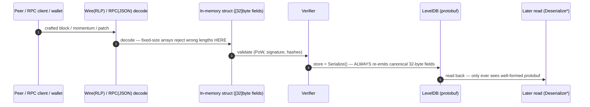

# Findings — go-zenon fuzzing (release/0.0.9 @ 60cf7d9)

Last updated 2026-10-09T17:21Z.

## Triage axis: reach, not just "it panics"

A panic only matters if a **third party can drive the input to it across a
trust boundary**. That is the one axis this report ranks on:

- **REMOTE → CRITICAL.** A peer (p2p), an RPC client, or any wallet can trigger
  it. Unauthenticated-remote-DoS class.
- **LOCAL → LOW.** The malformed input only exists through on-disk corruption or
  an operator/malware with write access to the data dir. A robustness defect,
  not an attack.

### Why most decode bugs here are LOCAL, not remote

The in-memory ledger types are **fixed-size arrays** — `Hash [32]byte`,
`Address [20]byte`, `ZenonTokenStandard [10]byte`. Everything that enters from
outside is forced through these before it can be stored:



The protobuf storage decoders (`DeserializeAccountBlock`, `DeserializeMomentum`)
and the patch loader sit on the **read** side of that boundary. By the time any
attacker bytes could reach them they have been round-tripped through a
fixed-size struct and re-serialized, so the malformed field cannot exist there
except through local corruption. Syrius cannot reach them; a malicious producer
stuffing a momentum cannot reach them.

## Confirmed crashers

All four reproduce (`cd fuzz && go run ./poc`), all saved as regression
reproducers under `fuzz/*/testdata/fuzz/`.

| # | Function | Panic | Reach | Severity |
|---|----------|-------|-------|----------|
| 1 | `nom.DeserializeAccountBlock` | nil-deref `DeProtoHash` (hash.go:87) | **local** | LOW |
| 2 | `nom.DeserializeMomentum` | nil-deref `DeProtoHash` (hash.go:87) | **local** | LOW |
| 3 | `db.NewPatchFromDump` | `slice bounds [-1297…:]` (patch.go:30) | **local** | LOW |
| 4 | `abi.NewType("")` | `index out of range [0]` (type.go:100) | **local** (not node-reachable) | LOW |

1–3 share one shape: a lenient decoder meets a length/nil assumption and
panics **before** the caller's error handling runs (the store readers are
written to return an error; the patch readers wrap in `DealWithErr`). Impact is
availability on a node whose on-disk DB is already damaged — it crash-loops on
restart instead of reporting corruption. #4 is not reachable in the stock node
at all (embedded ABIs are fixed compile-time strings); it is a latent crash for
off-node tooling that parses untrusted ABI JSON.

### The caveat that would flip 1–3 to CRITICAL

These bugs sit exactly on the boundary that **peer-to-peer state distribution**
would cross. If a future feature ships raw serialized blocks / patches / state
snapshots between nodes and writes them to LevelDB *before* the re-serialization
step — which is what the zenon-fastsync and Sentinel-snapshot work aim to do —
a malicious snapshot server could panic every importing node. Fix them before
snapshot sync ships. The fixes are cheap: length/nil checks in the `DeProto*`
helpers (return an error instead of panicking) so the existing error branches
run; a `len(result)==0` check in `NewType`; and an `int`-truncation guard on the
goleveldb batch length.

## External surfaces fuzzed that HELD UP (no crash found)

These are the paths a third party actually reaches. Finding a crash in any of
them would be CRITICAL; none has surfaced yet (short soaks — keep running).

| Surface | Harness | Reachable by | Result |
|---|---|---|---|
| p2p `TxMsg` → `ApplyBlock` (no recover) | `remote.FuzzPeerTxRaw` | any peer, unauth | robust in ~120k execs: clean error, no panic, no hang |
| signed send executor (valid sig) | `remote.FuzzPeerTxSigned` | any wallet | robust; needs longer soak (~slow, signs per input) |
| full JSON-RPC pipeline (envelope → args → dispatch) | `remote.FuzzRPCRequest` | any RPC client | robust in ~96k execs: real server + real public APIs on a mock node |
| embedded-contract ABI unpack of call `Data` | `abi.FuzzEmbeddedUnpack` | any wallet | robust in ~1M execs |
| RLP wire (account block / detailed momentum) | `decode.Fuzz*RLP` | any peer | robust |
| account-block JSON (RPC publish param) | `types.FuzzAccountBlockJSON` | any RPC client | robust |
| address / ZTS / hash parsers (RPC args) | `types.Fuzz*` | any RPC client | robust |
| full stateful node program | `chain.FuzzChainProgram` | wallet-equivalent | robust; slow, needs soak |

### A relevant structural observation (not a crash, but worth fixing)

`Supervisor.ApplyMomentum` wraps VM execution in `defer recover()` → a panic in
contract code becomes `ErrVmRunPanic` and the momentum is rejected.
`Supervisor.ApplyBlock` has **no such recover**, and the p2p `TxMsg` path
(`chainBridge.AddAccountBlocks`) calls it with no recover above it either. So
the account-block apply path is the one exposed to a would-be remote panic,
while the contract-execution path (reached on the contract *receive*, under
`ApplyMomentum`) is protected. That asymmetry is why the fuzzing effort is
pointed at `ApplyBlock`. By contrast `LedgerApi.PublishRawTransaction` (the RPC
submit path) defends itself with `defer common.RecoverStack()`.

## Harness-fidelity note (why a finding was discarded)

An early version of `FuzzRPCRequest` used a custom codec that copied raw bytes
straight into the server's message parser. It flagged the input `"["` as a
hang. On inspection that was a **harness artifact, not a node bug**: the real
server codec wraps a `json.Decoder`, which requires a *complete* JSON value, so
a real client sending `"["` gets a decode error (or the per-connection socket
read simply waits for the rest — a normal per-connection wait, not a
server-wide hang). The harness was made faithful by using the production
`server.NewCodec` over a real reader; `"["`, `"{"`, `""` and other fragments
now reject in microseconds. Rule applied throughout: **a harness must not be
more permissive than the real transport, or it reports crashes/hangs no third
party can actually trigger** — which is exactly the opposite of what this
effort is for.

## How to reproduce / keep hunting

```bash
cd fuzz
go run ./poc                 # demonstrate all four crashers + impact
make sweep FUZZTIME=120s     # all targets, bucketed report in ./findings
go test ./remote/ -run=xxx -fuzz=FuzzPeerTxRaw    -fuzztime=10m -parallel=1
go test ./remote/ -run=xxx -fuzz=FuzzPeerTxSigned -fuzztime=10m -parallel=1
go test ./remote/ -run=xxx -fuzz=FuzzRPCRequest   -fuzztime=10m -parallel=1
```
