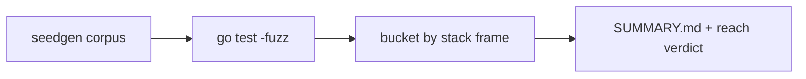

# go-zenon-fuzz

Adversarial fuzzing of [go-zenon](https://github.com/zenon-network/go-zenon)
`release/0.0.9`, pinned as the `go-zenon/` submodule and left untouched. A
separate Go module under `fuzz/` drives coverage-guided, in-process fuzzers at
the node's parsers, its wire and JSON-RPC entry points, and the stateful
block-apply pipeline.

Findings and their severity live in **[FINDINGS.md](FINDINGS.md)**.

## Triage: reach, not just "it panics"

A crash is CRITICAL only when a third party can drive input to it across a trust
boundary — a p2p peer, an RPC client, a wallet. A crash reachable only through
on-disk corruption or off-node tooling is LOW. Every run's report classifies its
targets this way; see [FINDINGS.md](FINDINGS.md).

## Flow



## Run

```bash
git clone --recurse-submodules <repo-url>
cd go-zenon-fuzz/fuzz

make sweep FUZZTIME=60s   # fuzz every target; report written to ./findings
make race                # directed pool concurrency probe under -race
make cover               # node coverage reached by the corpus
make regress             # replay the committed crashers
```

After a plain `git clone`, run `git submodule update --init` to fetch the node
before building.
